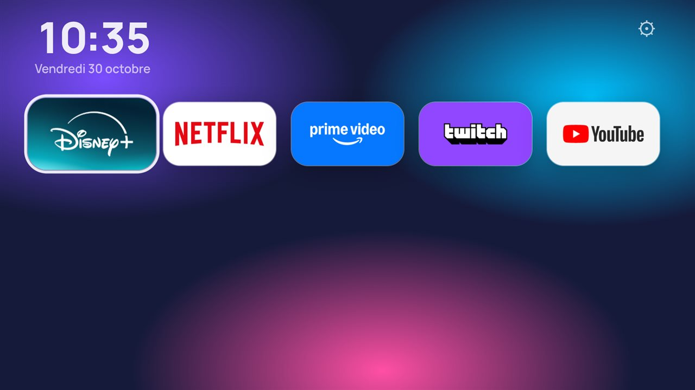
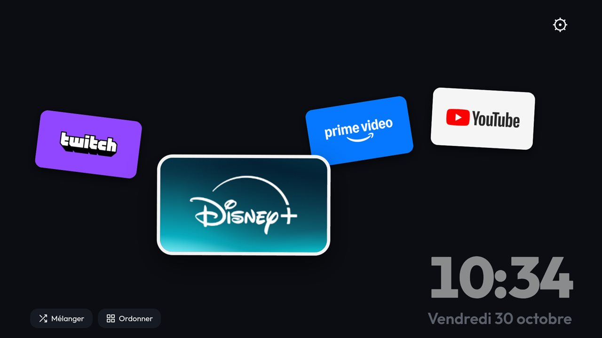
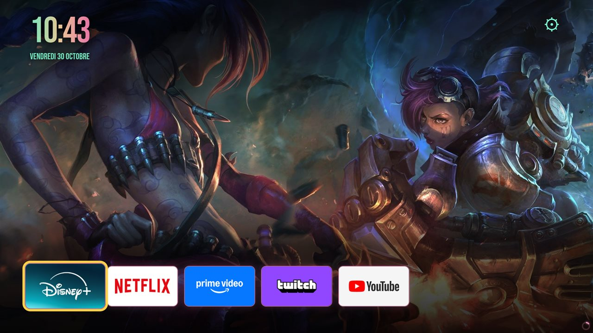
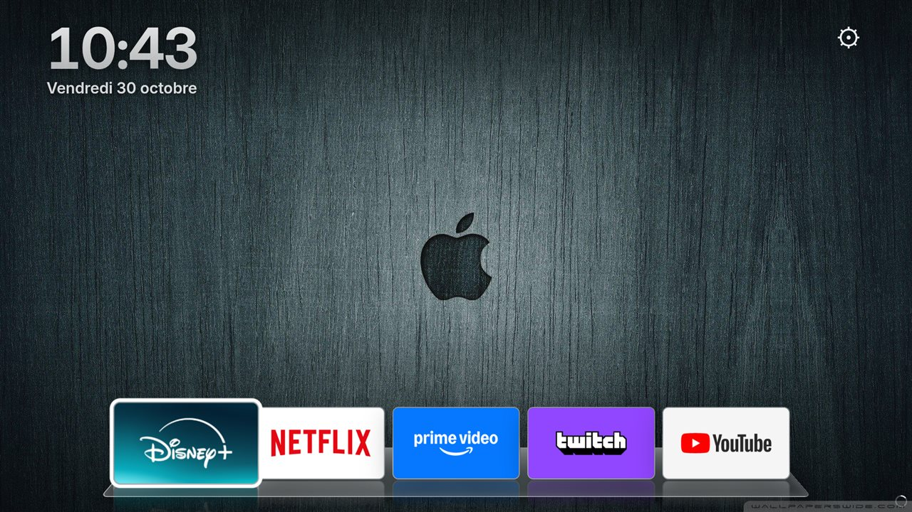
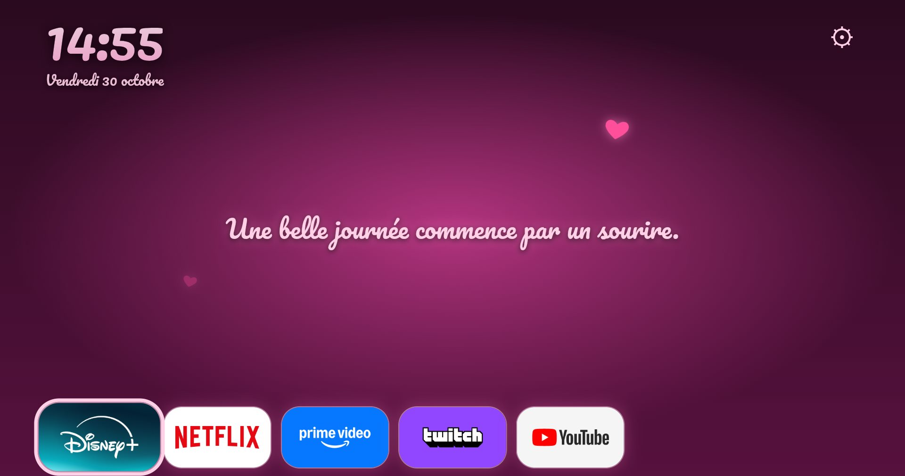
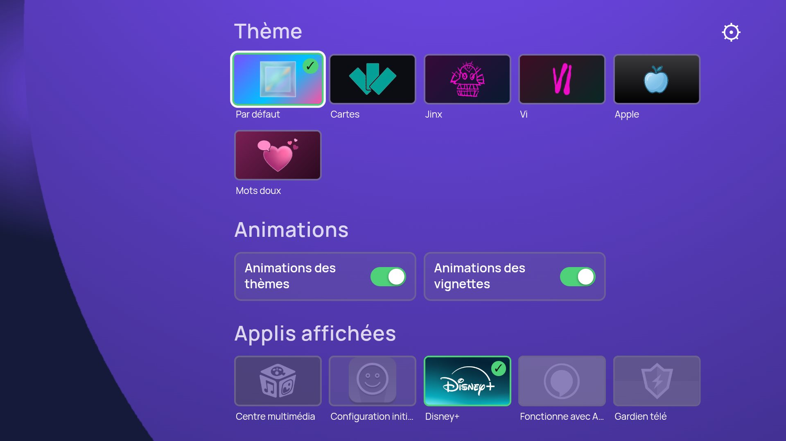
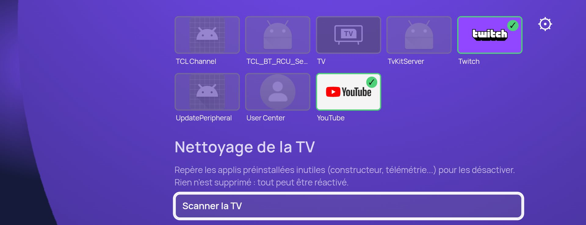
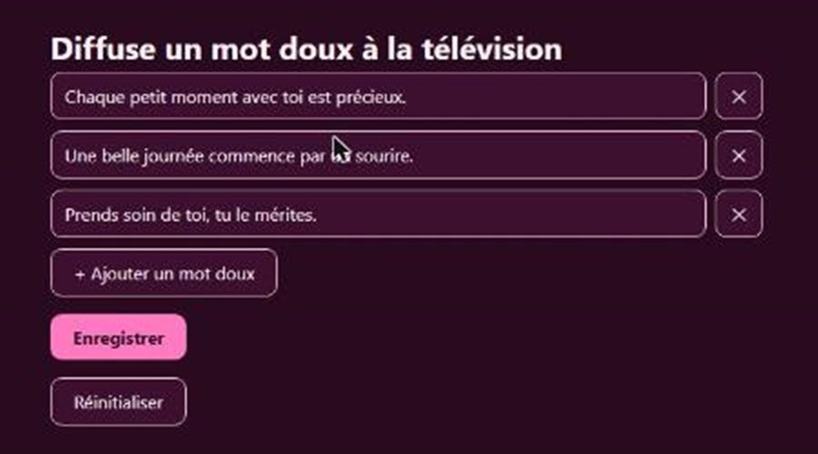

# Nodecount TV

Un écran d'accueil sur mesure pour Android TV. Il remplace le launcher d'origine de la télé par quelque chose de plus beau et de plus personnel : l'heure et la date en grand, les applications bien rangées, et un thème choisi parmi plusieurs ambiances.

L'appli peut aussi s'installer **uniquement pour alléger la télé** : son outil de nettoyage scanne les applications préinstallées, repère celles qui sont inutiles, gourmandes ou qui envoient des données (télémétrie), puis les désactive en un clic. Le nettoyage fait, il est possible de revenir au launcher d'origine de la télé : les applications désactivées le restent.



## Sommaire

- [Ce que ça fait](#ce-que-ça-fait)
- [Les thèmes](#les-thèmes)
- [Les paramètres](#les-paramètres)
- [Modifier les mots doux](#modifier-les-mots-doux)
- [Optimiser la télé](#optimiser-la-télé)
- [Installer](#installer)
  - [Envoyer l'appli sur la télé avec ADB](#envoyer-lappli-sur-la-télé-avec-adb)
- [Inspiration](#inspiration)
- [Compiler soi-même](#compiler-soi-même)
- [Visuels et droits](#visuels-et-droits)

## Ce que ça fait

- **Des thèmes pour tous les goûts**, du plus sobre au plus coloré, certains avec des fonds d'écran en diaporama ou de la musique d'ambiance.
- **Des animations réglables.** Les animations des thèmes et celles des vignettes se coupent séparément. Utile sur une télé peu puissante : avec les animations coupées, une application sélectionnée est simplement entourée d'une bordure.
- **Tout reste à la maison.** L'appli ne dépend d'aucun service en ligne : tout se passe sur la télé et le réseau local.

## Les thèmes

<table>
  <tr>
    <td width="50%" valign="top">
      <br>
      <b>Par défaut</b><br>
      Des dégradés doux et des vignettes arrondies
    </td>
    <td width="50%" valign="top">
      <br>
      <b>Cartes</b><br>
      Les applications posées comme des cartes sur une table
    </td>
  </tr>
  <tr>
    <td width="50%" valign="top">
      <br>
      <b>Jinx</b><br>
      Fonds d'écran et graffitis néon
    </td>
    <td width="50%" valign="top">
      <br>
      <b>Vi</b><br>
      Un fond d'écran en diaporama
    </td>
  </tr>
  <tr>
    <td width="50%" valign="top">
      <br>
      <b>Apple</b>
    </td>
    <td width="50%" valign="top">
      <br>
      <b>Mots doux</b><br>
      Un message et des cœurs qui flottent, à modifier depuis un navigateur du réseau local (protégé par un code PIN)
    </td>
  </tr>
</table>

## Les paramètres

Un clic sur la roue dentée en haut à droite ouvre les paramètres, qui se règlent entièrement à la télécommande :

- **Thème** : le choix de l'ambiance.
- **Animations** : couper séparément celles des thèmes et celles des vignettes.
- **Applis affichées** : choisir les applications qui apparaissent sur l'écran d'accueil.
- **Nettoyage de la TV** : repérer les applications préinstallées inutiles (constructeur, télémétrie...) et les désactiver en un clic. Rien n'est supprimé, tout se réactive.
- **Mots doux** : l'adresse de la page pour modifier les messages du thème du même nom.





## Modifier les mots doux

Depuis un ordinateur ou un téléphone du même réseau, ouvrir l'adresse indiquée dans les paramètres. Le code PIN s'affiche sur la télé, puis il est possible d'ajouter, de modifier ou de supprimer les messages.



## Optimiser la télé

Une télé Android TV est livrée avec de nombreuses applications préinstallées que personne n'a choisies : statistiques d'usage et rapports envoyés au constructeur, boutique et services du constructeur, assistants vocaux, mode démonstration des magasins, services Google ou de tiers jamais utilisés. Elles tournent en arrière-plan, occupent de la mémoire, ralentissent l'interface et collectent des données.

L'outil « Nettoyage de la TV » des paramètres s'en occupe :

1. **Scanner la TV** : l'appli compare les applications installées à une liste connue (`launcher/app/src/main/assets/bloat.json`) et n'affiche que celles qui sont présentes. Chaque ligne indique le nom de l'appli, sa catégorie (télémétrie et rapports, constructeur, Google, services de tiers, accessibilité) et pourquoi elle est signalée.
2. **Choisir** : un interrupteur par ligne permet de désactiver ou de réactiver les applications une par une, ce qui laisse le temps de décider. « Tout désactiver » et « Tout réactiver » traitent la liste d'un coup.
3. **Vérifier** : chaque basculement est appliqué tout de suite, et l'état affiché est relu sur la télé.

À savoir :

- Les applications sont **désactivées, pas désinstallées** : elles ne tournent plus et ne consomment plus rien, mais restent sur la télé et se réactivent à tout moment. Rien n'est supprimé.
- Une appli Android ne peut pas désactiver les autres. L'outil passe donc par l'ADB de la télé elle-même. Il faut pour cela activer le **débogage réseau** dans les options pour développeurs (voir la procédure d'installation plus bas), puis accepter une fois la fenêtre d'autorisation qui s'affiche sur l'écran, en cochant « Toujours autoriser ».
- La liste a été préparée sur une télé TCL. Les applications du constructeur d'une autre marque ne s'y trouvent pas forcément, mais les applications Google et de tiers sont reconnues partout. Le fichier `bloat.json` se complète facilement.
- La liste contient aussi des services d'accessibilité comme TalkBack : à garder activés si l'on en a besoin.
- Pour **revenir au launcher d'origine**, choisir de nouveau l'écran d'accueil de la télé dans ses paramètres (le nom du menu varie selon les modèles, souvent « Écran d'accueil » dans les préférences de l'appareil). Les applications désactivées le restent, et le nettoyage peut être annulé depuis Nodecount TV avec « Tout réactiver ».

## Installer

1. Télécharger `nodecount-tv.apk` dans la [dernière version](https://github.com/nodecount/Nodecount-TV/releases/latest).
2. L'installer sur la télé, avec une clé USB ou, plus simplement, depuis un ordinateur avec ADB (voir ci-dessous).
3. Choisir Nodecount TV comme écran d'accueil quand Android le propose.

Il faut Android TV 9 ou plus (API 28).

### Envoyer l'appli sur la télé avec ADB

1. **Installer ADB** sur l'ordinateur : télécharger les [Platform Tools d'Android](https://developer.android.com/tools/releases/platform-tools), décompresser l'archive, et ouvrir un terminal dans ce dossier (ou l'ajouter au PATH).
2. **Activer le mode développeur sur la télé** : dans Paramètres > Système > À propos, appuyer sept fois sur « Build » (ou « Numéro de build »). Aller ensuite dans Options pour les développeurs et activer le **débogage USB** (ou « débogage réseau », selon les télés).
3. **Trouver l'adresse IP de la télé** : Paramètres > Réseau et Internet, puis le réseau auquel elle est connectée. L'adresse est formée de quatre nombres séparés par des points. L'ordinateur doit être sur le même réseau.
4. **Se connecter à la télé** (en remplaçant `ADRESSE_IP` par celle de la télé) :

   ```
   adb connect ADRESSE_IP:5555
   ```

   Une fenêtre s'affiche sur la télé pour autoriser l'ordinateur : l'accepter avec la télécommande, en cochant « Toujours autoriser ».
5. **Envoyer l'appli** depuis le dossier où se trouve l'APK :

   ```
   adb -s ADRESSE_IP:5555 install -r nodecount-tv.apk
   ```

   Le message `Success` confirme l'installation.

Si `adb devices` affiche `unauthorized`, accepter la fenêtre sur la télé puis relancer la commande.

## Inspiration

Nodecount TV s'inspire de [Projectivy Launcher](https://play.google.com/store/apps/details?id=com.spocky.projengmenu), un launcher alternatif pour Android TV, disponible sur le Play Store. Il a été installé et testé sur la télé de l'auteur avant la création de ce projet, et il reste une excellente option pour qui préfère une solution toute faite et très complète. Nodecount TV est un projet indépendant, plus petit, centré sur les thèmes, le nettoyage de la télé et les mots doux.

## Compiler soi-même

Le code est une appli Android en Kotlin qui affiche une interface web (`launcher/app/src/main/assets/index.html`). Les étapes pour compiler et installer sont dans [`launcher/README.md`](launcher/README.md).

## Visuels et droits

Le code est publié sous licence MIT (voir le fichier [LICENSE](LICENSE)). Elle ne couvre pas les visuels et les musiques. Les thèmes reprennent en effet des univers de tiers (graffitis Arcane, fonds d'écran, logos d'applications, musiques) qui appartiennent à leurs ayants droit : ils sont fournis pour un usage personnel et non commercial.
